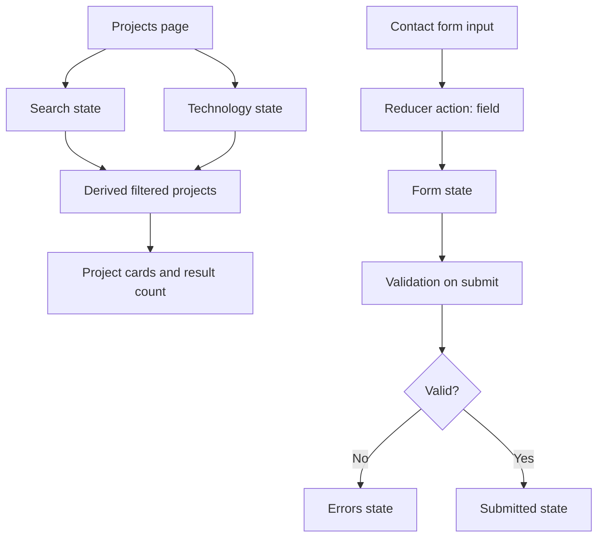

# Weeks 3–5 Evidence Notes

## Week 3 — State, Forms and Data Flow

### State-driven Projects page
- Search is controlled by `search` state.
- Technology selection is controlled by `technology` state.
- `filteredProjects` is derived with `useMemo`; it is not stored separately, avoiding duplicated state.
- `technologies` is derived from the project data.
- The clear-filters action resets both controls.

### Reducer-driven contact form
- `useReducer` manages the name, email, message, errors, and submission status.
- Reducer actions: `field`, `errors`, `submitted`, and `reset`.
- Validation is a pure function. Submission prevents default browser navigation and dispatches either errors or success state.
- The form is a demo and does not send messages to a backend.

### State flow

## Week 4 — Effects, APIs and Async UI

- Projects page requests public repositories from GitHub's REST API.
- Uses `fetch`, checks `response.ok`, parses JSON, and renders repository cards.
- UI states: loading, success, empty, and error with retry.
- Initial request uses `AbortController` in `useEffect` cleanup to abort when the page unmounts.
- Assumption: GitHub username is `ahashimbala` and the endpoint returns public repositories. API rate limits or network failures may trigger the error state.

## Week 5 — AI-Assisted Workflow Review

Use AI as an explainer, planner and reviewer. Verify its advice against the code, official React documentation, and browser behavior.

### Prompt comparison exercise
1. **Broad:** “How can I add search to my Projects page?” — likely broad suggestions; check whether it recommends unnecessary state.
2. **Context-rich:** “In my React Projects page, I have a fixed projects array. I need controlled search and technology filtering. Propose a plan without writing code and avoid storing derived results in state.” — expected to be more specific and constrained.
3. **Reviewer:** “Review my implementation for duplicated state, accessibility, and edge cases. Do not rewrite it. Give findings with reasons.” — focused critique.

### Verification checklist
- Confirm controlled inputs use `value` and `onChange`.
- Confirm derived filtered results are computed from source data and filter state.
- Confirm labels are associated with controls and keyboard focus is visible.
- Confirm API response is checked before JSON is treated as successful.
- Confirm loading, empty, error, and retry behavior in the browser.
- Record any AI suggestions that are accepted, modified, or rejected only after actually testing them.

### AI usage log template
| Suggestion | Decision | Reason / verification |
|---|---|---|
| Add search and technology filter | Accepted | Implemented and tested with matching and no-match queries |
| Store filtered results in separate state | Rejected if suggested | Derived values avoid keeping duplicated state in sync |
| Add API loading/error/empty UI | Accepted | API UI states implemented; verify network conditions in browser |

**Important:** Fill in the final AI review findings with your real prompt outputs and tests. Do not claim an AI hallucination was found unless you actually observed and verified one.
